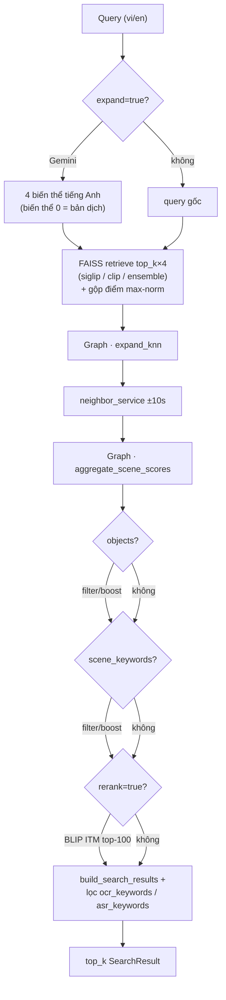
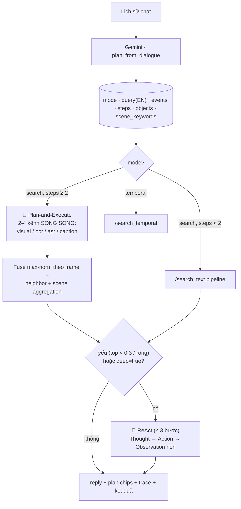

# Phân tích hệ thống HCM-AIC-2026 & đề xuất cải tiến độ chính xác

> Tài liệu phân tích luồng xử lý hiện tại của hệ thống **HCM-AIC-2026** (FastAPI + FAISS +
> SigLIP/CLIP + Gemini) và đề xuất các hướng cải tiến để nâng cao độ chính xác tìm
> kiếm. Ghi nhận ngày 2026-07-29, dựa trên mã nguồn `backend/`, `data_processing/` và
> `frontend/` tại commit hiện tại.

---

## 0. TL;DR

Hệ thống đã được xây dựng **chỉn chu** (theo đúng công thức 2 paper hệ thống thi
AIC/VBS là arXiv:2512.12935 và arXiv:2504.08384), nhưng vẫn còn **nhiều dư địa cải
tiến**, chia thành 3 nhóm:

- **A - Sửa luồng hiện tại** (ưu tiên cao, thấp rủi ro): chủ yếu là các điểm
  pipeline đang bị bỏ sót hoặc dùng model yếu.
- **B - Thêm hướng mới** (tầm trung–lớn): áp dụng kỹ thuật SOTA hiện nay mà
  hệ thống chưa có.
- **C - Đề xuất thứ tự ưu tiên** (effort vs impact) ở cuối tài liệu.

Khuyến nghị bắt đầu bằng: **(1) build evaluation set**, **(2) thay EasyOCR bằng
Qwen2.5-VL**, **(3) VLM rerank** cho các truy vấn khó.

---

## 1. Tổng quan hệ thống hiện tại

### 1.1 Pipeline offline (chạy 1 lần / khi có batch mới)

| Bước | Script | Output |
|------|--------|--------|
| 01 | `01_extract_keyframes.py` (TransNetV2) | `media/frames/Keyframes/<batch>/<video>/<idx>.webp` + `frames_meta.json` |
| 02 | `02_extract_features.py` | `features/<model>/<video>/<frame>.npy` |
| 03 | `03_build_faiss_index.py` (dedup 0.9) | `<model>.index` + `id_map_<model>.json` |
| 04 | `04_extract_ocr.py` (EasyOCR vi+en) | `ocr/ocr_data.json` |
| 05 | `05_extract_asr.py` (faster-whisper) | `asr/asr_data.json` |
| 07 | `07_build_text_indexes.py` (E5) | `ocr_text.index`, `asr_text.index`, `caption_text.index` |
| 08 | `08_build_graph.py` (`--knn`) | `graph/graph.json`, `graph/knn_<model>.json` |
| 09 | `09_extract-ocr-caption-qwen.ipynb` (Qwen2.5-VL) | OCR thay step 4 + `captions/caption_data.json` |

### 1.2 Pipeline online (5 chế độ tìm kiếm)

`POST /search_text` (`backend/routers/search_text.py:31`) - luồng chính:



Các chế độ khác dùng chung khối trên: `/search_image` (encode ảnh thay text, không
expand/rerank), `/search_ocr` `/search_asr` (E5 semantic + exact/fuzzy),
`/search_temporal` (retrieve từng event → beam search chuỗi).

### 1.3 Luồng agent (MemoriEase-style)

`POST /agent/chat` (`backend/routers/agent.py:39`):



`POST /agent/qa` - RAG: lấy frames, gửi ảnh + OCR/ASR cảnh cho Gemini vision trả lời.

---

## 2. A - Cải tiến luồng hiện tại (ưu tiên cao, thấp rủi ro)

### A1. `/search_image` đang bị bỏ sót nhiều bước quan trọng

**Vị trí**: `backend/routers/search_image.py:36-39`

```python
raw = expand_knn(raw, model=model if model != "ensemble" else settings.default_model)
raw = aggregate_neighbor_scores(raw)
raw = aggregate_scene_scores(raw)
results = build_search_results(raw, top_k=top_k)
```

So với `/search_text` (`backend/routers/search_text.py:84-96`), endpoint này **thiếu**:

- Query expansion (Gemini sinh biến thể)
- BLIP ITM rerank
- Object / scene_text filter/boost
- Post-filter `ocr_keywords` / `asr_keywords`

**Hướng sửa**: thêm vào chuỗi post-processing giống `/search_text`, đồng thời
nên dùng Gemini mô tả ảnh query (image captioning) rồi chạy luôn pipeline text -
một số ảnh user upload có thể trực tiếp match tốt hơn bằng text description
(ví dụ: ảnh mờ, ảnh chụp màn hình có nhiều text).

### A2. BLIP ITM quá yếu cho visual rerank

**Vị trí**: `backend/config.py:71`

```python
visual_rerank_model: str = "Salesforce/blip-itm-base-coco"
```

BLIP base chỉ là phân lớp nhị phân (match/no-match), cross-attention nông. Có 3
lựa chọn mạnh hơn:

| Model | Ưu điểm | Nhược |
|-------|---------|-------|
| `Salesforce/blip2-itm-vit-g` | Cross-attention sâu, accuracy +5–8% | Lớn hơn ~3GB VRAM |
| `BAAI/AltCLIP` | Đa ngữ tốt hơn | Đã thử cho retrieval chính thì yếu |
| **VLM rerank** (Gemini vision chấm top-K) | Hiểu cả visual + OCR + ASR cùng lúc | ~2-5s/request, tốn quota |

`VISUAL_RERANK_MODEL` đã có sẵn để swap model. Có thể thêm `VISUAL_RERANK_VLM=enabled`
để fallback sang Gemini vision khi top score thấp.

### A3. OCR/ASR chỉ có semantic + exact, thiếu BM25

**Vị trí**:
- `backend/services/ocr_service.py:46-79` - exact score = `count(q) / word_count`
- `backend/services/asr_service.py:70-79` - cùng công thức

Với query dài nhiều từ, `count(q)/word_count` không phản ánh tốt độ quan trọng tương
đối của các term. BM25 sẽ xếp hạng tốt hơn nhiều. Có thể:

- Thêm `rank_bm25` (`pip install rank-bm25`) cho OCR/ASR exact pass
- Hoặc tự tính IDF đơn giản theo toàn bộ corpus
- Kết hợp với semantic bằng **Reciprocal Rank Fusion (RRF)** (chuẩn SOTA hiện nay)

### A4. E5 multilingual-base đã cũ

**Vị trí**: `backend/config.py:55`

```python
text_embed_model: str = "intfloat/multilingual-e5-base"  # 768-d, đa ngữ (vi)
```

**BGE-M3** (`BAAI/bge-m3`, 1024-d) hiện đang SOTA multilingual retrieval, hỗ trợ:

- Dense retrieval (1024-d)
- Sparse retrieval (BM25-style trong cùng model)
- Multi-vector (ColBERT-style late interaction)
- Đặc biệt tốt cho tiếng Việt + truy vấn dài

Để swap cần:
1. Build lại `data/indexes/{ocr,asr,caption}_text.index` với BGE-M3
2. Sửa `services/text_embedding_service.py` (model + dim)
3. Sửa `data_processing/07_build_text_indexes.py` (script build)

### A5. Qwen2.5-VL OCR (kaggle notebook 09) chưa vào production

**Vị trí**:
- `data_processing/kaggle/09_extract-ocr-caption-qwen.ipynb` - đã build
- `data_processing/04_extract_ocr.py` - vẫn dùng **EasyOCR** (local pipeline)

EasyOCR nhận diện text Tiếng Việt kém xa Qwen2.5-VL. Đây là **quick-win lớn nhất**
về recall OCR. Cần:

1. Viết lại `04_extract_ocr.py` dùng Qwen2.5-VL (đã có notebook mẫu)
2. Hoặc tạo script mirror logic notebook 09 cho local
3. Cache model, batch processing, resumable

### A6. ReAct chỉ 3 bước + tools hạn chế

**Vị trí**: `backend/services/agent_service.py:381`

```python
for step in range(1, settings.react_max_steps + 1):  # max 3
    text = _gemini_generate(parts, temperature=0.2, model=react_model)
    ...
```

Cải tiến:

- **Tăng `react_max_steps`** lên 5–7 cho query khó
- **Thêm tools**:
  - `expand_scene(frame_id)` - lấy tất cả frame trong cùng cảnh
  - `find_in_video(video_name, query)` - giới hạn search trong 1 video
  - `narrow_by_time(start_ms, end_ms, query)` - query trong khoảng thời gian
  - `similar_to(frame_id, top_k)` - mở rộng từ 1 frame điểm
- **Observation nén quá mạnh** - chỉ thấy top-3 scene info / 5 frames. Agent mù
  thông tin về tail. Nên hiển thị thống kê video cluster (top-5 video × top-3 frame).

### A7. Cache embedding theo query chưa persistent

**Vị trí**:
- `backend/services/query_expansion_service.py:24-26` - cache trong process
- `backend/services/embedding_service.py:250` - encode lại mỗi request

Vấn đề:

- Multi-instance (uvicorn workers > 1) → mỗi worker cache riêng
- Restart → mất toàn bộ cache
- Cùng query user bấm nhiều lần (search lại) → encode lại

Hướng sửa:

- `@lru_cache(maxsize=1024)` cho `encode_text` (cache theo query hash + model)
- Hoặc Redis cho multi-instance
- Cache cả FAISS result (post-process output) cho query phổ biến

### A8. kNN expansion đặt TRƯỚC rerank

**Vị trí**: `backend/routers/search_text.py:84-93`

```python
raw = expand_knn(raw, ...)        # ← thêm candidate mới
raw = aggregate_neighbor_scores(raw)
raw = aggregate_scene_scores(raw)
if objects.strip():
    raw = apply_object_filter(raw, objects, mode=object_mode)
if scene_keywords.strip():
    raw = apply_scene_text_filter(raw, scene_keywords, mode=scene_mode)
if rerank:
    raw = rerank_frames(queries[0], raw)  # ← rerank head (top-N)
```

`rerank_frames` chỉ re-score `head` (top N theo retrieval order), nên frames từ
kNN expansion nằm ở cuối pool sẽ bị đẩy xuống `tail` và **không được rerank**.

Hai lựa chọn:

1. **Đảo thứ tự**: rerank trước trên top retrieval gốc, rồi mới `expand_knn` trên
   top reranked. Nhược: frames mới từ kNN không được rerank.
2. **Rerank toàn bộ pool mở rộng**: tốn hơn (BLIP ITM trên nhiều frames hơn)
   nhưng chính xác hơn. Cần kiểm tra VRAM.

Cũng cân nhắc: **tăng `RERANK_CANDIDATES`** từ 100 lên 150–200.

### A9. Thiếu evaluation infrastructure

**Vấn đề**: Không có ground-truth test set → mọi thay đổi rerank/weight đều đoán mò.

Cần build ngay:

1. **50–100 query mẫu có ground truth** (frame chính xác theo từng query)
2. **Script đo lường**: Recall@5, Recall@10, Recall@20, MRR, mAP
3. **A/B test framework**: chạy baseline vs candidate, so sánh metric
4. **Track per-category** (text/image/ocr/asr/temporal/agent) để biết thay đổi nào
   hưởng đến loại nào

Có thể tận dụng 700+ keyframes có sẵn + caption để tự sinh query mẫu
(Qwen2.5-VL sinh query từ caption → dùng làm pseudo-ground-truth).

---

## 3. B - Phương án mới cần phát triển (tầm trung–lớn)

### B1. VLM reranker (Gemini vision chấm top-K) ⭐

**Bước nhảy lớn nhất về accuracy** theo hướng SOTA hiện nay:

```
top-20 frames → gửi cho Gemini vision kèm OCR/ASR + query
              → yêu cầu xếp hạng lại + giải thích
              → trả về list sorted + reasoning
```

- **Ưu**: hiểu được semantic + visual + text đồng thời, không lỗi OCR, không lỗi
  ngôn ngữ (Tiếng Việt ↔ Tiếng Anh tự nhiên)
- **Nhược**: ~2–5s/request, tốn quota Gemini, latency cao
- **Cân bằng**: chỉ kích hoạt khi `top_score < 0.5` (giống logic ReAct hiện tại)
- **Implementation**: thêm vào `services/agent_service.py`, tool mới
  `vlm_rerank(query, frame_ids, top_k)` cho ReAct agent

**So sánh với BLIP ITM hiện tại**: Gemini có thể nhìn OCR text + ASR context +
visual content cùng lúc, BLIP ITM chỉ thấy visual + 1 câu query.

### B2. Multimodal late interaction (ColPali/ColQwen)

Lưu embedding **per patch** (thay vì 1 vector/frame) → query cũng patch-level →
late interaction scoring. Tốt cho text trong ảnh mà Qwen2.5-VL caption bỏ sót
(ví dụ: biển số xe, chữ nhỏ trên banner).

- **Model gọn nhất**: `vidore/colqwen2-v1` (Qwen2-VL backbone, đã optimize)
- **Index format**: cần custom (FAISS không hỗ trợ multi-vector natively), có
  thể dùng `pylate` hoặc tự build IVF
- **Effort**: cao (1–2 tuần) - thay đổi kiến trúc index

### B3. BEiT-3 vào ensemble

**Vị trí**: `backend/config.py:30`

```python
ensemble_models: str = "siglip:0.6,clip:0.4"
```

BEiT-3 (`unilm/beit3_large_patch16_384_retrieval`) là backbone **thắng AIC 2024**
đã được hỗ trợ trong pipeline (`data_processing/config.py` có key `beit3`) nhưng
chưa thấy trong ensemble chính.

**Cách thêm**:

1. `MODEL_KEY=beit3 python 02_extract_features.py` (cần unilm repo + checkpoint)
2. `MODEL_KEY=beit3 python 03_build_faiss_index.py`
3. Cập nhật `embedding_service._HF_NAME` map `beit3 → <hf-id>`
4. Set `ENSEMBLE_MODELS=siglip:0.5,clip:0.3,beit3:0.4`

### B4. Hierarchical search (video-level → frame-level)

Hiện tại search thẳng frame-level. Có thể:

1. Encode mỗi video = mean(embedding các frame, có attention) - precompute offline
2. Search video-level trước → lấy top-50 video candidates
3. Trong 50 video đó, mới search frame-level

**Lợi**:

- Recall cao hơn (video embedding ổn định hơn frame embedding)
- Rerank rẻ hơn (top-50 video = ~5000 frames thay vì 700k)
- Phù hợp với video-level query ("tin tức về bão Yagi")

**Effort**: trung bình (1 tuần) - thêm video index, sửa router.

### B5. Pseudo-relevance feedback (PRF)

Sau khi có kết quả đầu, tự động:

1. Lấy top-3 frames
2. Extract OCR/ASR/Caption của chúng
3. Mở rộng query bằng các term quan trọng (TF-IDF chọn top-K term)
4. Search lại với expanded query

**Lợi**: tăng recall ~5–10% (chuẩn trong literature), không cần user feedback.
**Effort**: thấp–trung bình.

### B6. Domain-adapt SigLIP/CLIP

Fine-tune SigLIP2 trên cặp (query AIC, ground-truth frame) nếu BTC cung cấp
training data. Nếu không, dùng feedback user làm hard negatives để contrastive
fine-tune.

**Effort**: cao (cần GPU lớn + data + thời gian). Nhưng nếu có training set của
AIC 2024, có thể cải thiện **rất nhiều**.

### B7. Scene-level caption (thay vì per-frame)

Qwen2.5-VL hiện caption từng frame. Caption cả **scene** (5–10 frame liên tiếp)
sẽ giàu context hơn - ví dụ "anchor đang đưa tin về bão Yagi" thay vì chỉ
"man talking".

- Build offline: lấy 5 frame đầu + 5 frame cuối của scene, gửi Qwen2.5-VL
- Index riêng (`scene_caption_text.index`)
- Thêm channel mới vào agent Plan-and-Execute

### B8. Hybrid sparse+dense retrieval cho text

Thêm BM25 index (`whoosh` hoặc `pyserini`) song song với FAISS. Kết hợp bằng
**Reciprocal Rank Fusion (RRF)**:

```
score(d) = Σ 1 / (k + rank_m(d))   for each model m
```

với `k ≈ 60`. Chuẩn SOTA hiện nay cho hybrid search.

### B9. Conversation memory cross-session

Agent hiện quên hết sau mỗi session. Lưu lại:

- Query thành công + frame đã pick (feedback positive)
- User preferences (loại nội dung hay tìm)
- Negative feedback (query nào luôn trượt)

Lần sau cùng chủ đề: gợi ý query tương tự thành công trước đó, hoặc dùng làm
context cho plan.

**Implementation**: thêm `services/memory_service.py` + storage (SQLite/Redis).

### B10. Audio-visual joint embedding

`ImageBind` (`facebook/imagebind`) hoặc `LanguageBind` có thể encode text + image
+ audio chung space. Nếu áp được cho ASR (audio raw) + frame, có thể bỏ qua bước
decode ASR hoàn toàn.

**Effort**: rất cao (research-grade). Hiện chưa có model audio cho Tiếng Việt tốt.

---

## 4. C - Đề xuất thứ tự ưu tiên (effort vs impact)

| Ưu tiên | Hạng mục | Effort | Impact | Ghi chú |
|---------|---------|--------|--------|---------|
| 🥇 P0 | **A5: Dùng Qwen2.5-VL OCR thay EasyOCR** | Trung bình | **Cao** | Swap 1 pipeline, OCR recall tăng mạnh |
| 🥇 P0 | **A9: Build evaluation set + script** | Thấp | **Cao** | Đo lường được, baseline cho mọi thay đổi |
| 🥈 P1 | A1: Bổ sung rerank/expand cho `/search_image` | Thấp | Trung bình | Endpoint đang bị bỏ sót nhiều bước |
| 🥈 P1 | A2: Đổi sang BLIP-2 ITM hoặc VLM rerank | Thấp | Trung bình–Cao | Config có sẵn, chỉ swap model |
| 🥈 P1 | A4: Đổi E5 → BGE-M3 | Trung bình | Trung bình | Rebuild index + sửa 2 file |
| 🥈 P1 | A6: Mở rộng ReAct tools + steps | Thấp | Trung bình | Thêm 4 tools, tăng max_steps |
| 🥈 P1 | A8: Sửa thứ tự kNN expansion vs rerank | Thấp | Trung bình | 1 dòng code |
| 🥉 P2 | **B1: VLM rerank cho hard cases** | Trung bình | **Cao** | Thêm 1 tool, tận dụng Gemini có sẵn |
| 🥉 P2 | B3: BEiT-3 vào ensemble | Trung bình | Trung bình | Pipeline đã hỗ trợ, chỉ enable |
| 🥉 P2 | A3: BM25 cho OCR/ASR | Thấp | Thấp–Trung bình | Thêm 1 dependency |
| P3 | B4: Hierarchical search | Cao | Trung bình | Thêm 1 tầng index |
| P3 | B5: PRF | Trung bình | Trung bình | Auto query expansion |
| P3 | B8: Hybrid sparse+dense | Cao | Trung bình | Thêm BM25 index + RRF |
| P3 | B7: Scene-level caption | Trung bình | Trung bình | Caption offline + index |
| P3 | B9: Conversation memory | Trung bình | Trung bình | Storage + retrieval |
| P4 | B2: ColPali/ColQwen | Cao | Cao (nhưng research) | Thay đổi kiến trúc index |
| P4 | B6: Domain-adapt SigLIP | Cao | Cao (cần data) | Fine-tune toàn bộ backbone |
| P4 | B10: Audio-visual joint | Rất cao | Chưa rõ | Research-grade |

---

## 4b. Đã làm (2026-09-03) - kèm số đo

Bộ eval `backend/eval/sotuyen12.json` (55 câu SOTUYEN1+2, kiểm tay bằng keyframe)
+ `scripts/eval_agent.py` / `scripts/eval_aggregate.py`. **A9 coi như xong**: mọi
thay đổi dưới đây đều có số đo trước/sau, trung vị qua nhiều lần chạy.

Ba lỗi vòng ReAct chưa từng lộ ra vì nó hỏng ÊM (trace rỗng trông y hệt "agent
thấy kết quả đủ tốt nên không làm gì"):

1. Model trả **nhiều object JSON nối nhau** trong một lượt; `json.loads` ném lỗi
   và vòng lặp dừng ngay bước 1. Sửa: `_parse_json_obj` lấy object đầu tiên.
2. Không gửi `max_tokens` cho endpoint OpenAI-compat -> reply dài bị cắt giữa
   JSON. Sửa: `openai_max_tokens` + log khi `finish_reason=length`.
3. `react_max_steps=3` hết hạn ngay sau khi vừa định vị xong. Sửa: 6.

Và một lỗi làm hỏng đuôi kết quả (A8 cùng họ): khi agent tự search lại được điểm
cao hơn, `react_refine` **thay** cả danh sách bằng kết quả mới. Search của ReAct
chạy một kênh, `rerank=False`, `expand=False` nên nghèo đuôi hơn fan-out ban đầu
-> mất phần rank 20-100, đúng phần mà bài nộp 100 dòng còn cứu được. Sửa: ghép
(`_merge_results`) - kết quả mới lên đầu, đuôi cũ giữ nguyên bên dưới.

### Số đo

`recall@k` = **số câu trung bình của MỘT lần chạy** có video đúng trong k dòng đầu
(trên 55 câu). Không dùng trung vị rank: số lần chạy chẵn thì rank (1, 2) ra 1.5 và
trượt `@1`, làm cấu hình chạy 2 lần bị chấm thấp hơn cấu hình chạy 3 lần dù dữ liệu
y hệt - `eval_aggregate.py` đã sửa chỗ này.

| Cấu hình | lần chạy | vid@1 | vid@5 | vid@20 | vid@100 | frm@1 | frm@100 |
|---|---|---|---|---|---|---|---|
| metaclip2, một lượt (nền) | 3 | 19.3 | 32.7 | 42.7 | 48.0 | 12.7 | 35.0 |
| metaclip2 + ReAct (thay) | 3 | 22.0 | 32.3 | 44.0 | 48.3 | 13.3 | 36.0 |
| metaclip2 + ReAct (ghép) | 2 | **23.0** | **35.5** | **44.5** | 50.0 | 12.0 | 36.5 |
| metaclip2+siglip512, một lượt | 2 | 21.0 | 31.5 | 41.5 | **51.5** | **14.0** | **37.0** |
| metaclip2+siglip512 + ReAct | 2 | 22.5 | 35.5 | 40.5 | 51.0 | 14.0 | 36.0 |
| siglip512 đơn | 2 | 17.5 | 29.0 | 39.5 | 48.5 | 12.0 | 36.0 |
| siglip đơn | 1 | 19.0 | 28.0 | 37.0 | 50.0 | 12.0 | 38.0 |
| metaclip đơn | 1 | 14.0 | 24.0 | 35.0 | 49.0 | 11.0 | 34.0 |
| 3 backbone | 2 | 19.5 | 30.5 | 39.0 | 48.5 | 13.5 | 35.0 |

Đọc bảng - **và đọc kèm mức nhiễu**: cùng một cấu hình, `vid@1` đổi ở 5-13 / 55 câu
giữa các lần chạy (router LLM không tất định), nên chênh lệch 1-2 câu giữa hai dòng
là **vô nghĩa**. Chỉ ba điều dưới đây đủ vững:

- **ReAct nâng đầu danh sách khoảng +3 câu `vid@1`**, đúng chiều trên cả hai
  backbone (19.3 -> 22-23). Đây là hệ quả của ba lỗi ở trên: trước khi sửa, vòng
  ReAct gần như chưa bao giờ chạy quá bước 1.
- **ReAct KHÔNG nâng frame** (`frm@1` 12-13 ở mọi cấu hình). `locate_by_asr` ghim
  đúng video và mốc thời gian thô; độ chính xác frame vẫn phụ thuộc keyframe có
  tồn tại hay không.
- **Trộn metaclip2 + siglip512 nâng trần recall** (`vid@100` 48.0 -> 51.5), cứu
  đúng nhóm mà metaclip2 đơn không bao giờ trả về: p2-5, p2-10, p2-23, p2-24,
  p2-25. Đổi lại kéo tụt p2-14, p2-22, p2-27, p2-30. **3 backbone không tốt hơn 2**.

Giá phải trả của ReAct: **9 giây/câu -> 25-40 giây/câu**. Trong phòng thi đây là
đánh đổi thật, không phải cải tiến miễn phí.

### Cấu hình đang chạy (chốt 2026-09-03)

`fusion_peak_bonus=0.0`, `plan_slide_rule=False`, `qa_zoom_pass=False`,
`react_max_steps=6`, `ENSEMBLE_MODELS=metaclip2:1.0`.

| `--deep`, 2-3 lượt | vid@1 | vid@5 | vid@20 | vid@100 | frm@100 |
|---|---|---|---|---|---|
| Nền (trước mọi thay đổi) | 22.0 | **32.3** | **44.0** | 48.3 | 36.0 |
| Chốt | 22.5 | 30.5 | 42.0 | **51.0** | **38.0** |

`vid@100` và `frm@100` là hai cột cao nhất trong MỌI cấu hình đã thử - đúng hai
cột quyết định trần điểm của bài nộp 100 dòng. Các cột đầu bảng nằm trong dao
động (7-13 / 55 câu đổi hạng giữa hai lượt cùng cấu hình).

**Chỉ hai thay đổi có bằng chứng vững** (đúng chiều trên mọi cặp so sánh):

1. Ba lỗi làm vòng ReAct chết ở bước 1 (parse JSON nhiều object, thiếu
   `max_tokens`, `react_max_steps` quá thấp). Sau khi sửa, `--deep` hơn một lượt
   ở `vid@1` trong mọi cặp: 19.3 -> 22.0 (nền), 18.0 -> 22.5 (chốt).
2. `_merge_results` - ghép thay vì thay danh sách trong `react_refine`.

Mọi thứ khác đều nằm trong nhiễu. Đừng tin một lượt chạy.

### BLIP rerank: không đo được lợi ích, tốn 32% thời gian

Frontend gọi `agentChat(history, topK, model, false, deep)` - tham số thứ tư là
`rerank`, **ghim cứng `false`** ([AgentChatPanel.jsx:110](../frontend/src/components/AgentChatPanel.jsx#L110)),
trong khi `AgentChatRequest.rerank` mặc định `True`. Nghĩa là giao diện thi đấu
chạy KHÔNG rerank. A/B 4 lượt mỗi bên, cùng cấu hình còn lại:

| Một lượt, 4 lượt chạy | vid@1 | vid@5 | vid@20 | vid@100 | frm@100 | giây/câu |
|---|---|---|---|---|---|---|
| rerank TẮT | 16.2 | 30.0 | 38.2 | 48.2 | 35.8 | **6.8** |
| rerank BẬT | 17.5 | 29.0 | 38.0 | 46.2 | 35.5 | 10.0 |

Mọi cột chênh dưới 2 câu và đổi chiều tuỳ cột. Giữ `rerank=false` vì **tốc độ**,
không phải vì chất lượng.

Cảnh báo phương pháp: cùng phép đo này với **2 lượt** cho ra "tắt rerank thắng
đậm" (`vid@20` 40.5 vs 37.0, `vid@100` 50.0 vs 47.5) - kết luận đó SAI, tan hết
khi lên 4 lượt. Với mức nhiễu 6-13 / 55 câu, **n=2 không đủ để kết luận gì**.

**Nhưng với `--deep` thì rerank là bắt buộc** - và đây là chênh lệch DUY NHẤT
trong toàn bộ đợt đo vượt hẳn nhiễu:

| `--deep`, 2 lượt | vid@1 | vid@5 | vid@20 | vid@100 | frm@100 | giây/câu |
|---|---|---|---|---|---|---|
| rerank TẮT | 14.5 | 25.0 | 34.5 | 43.0 | 33.0 | 15.0 |
| rerank BẬT | **22.5** | **30.5** | **42.0** | **51.0** | **38.0** | 19.9 |

Bật `deep` mà tắt rerank (14.5) còn **tệ hơn không bật deep** (16.2). Nguyên nhân
là một phụ thuộc THANG ĐIỂM ngoài ý muốn: `react_refine` quyết có ghép danh sách
hay không bằng `results[0]["score"] > best_score`. Tool `search` của ReAct luôn
chạy `rerank=False`, nên:

- rerank BẬT: `best_score` là điểm BLIP (thang khác, cao hơn) -> search một kênh
  của ReAct hiếm khi vượt -> đầu bảng của fan-out được giữ.
- rerank TẮT: hai bên cùng thang fusion -> ReAct thắng quá dễ và đè mất fan-out
  bằng một danh sách một-kênh nghèo hơn.

Vá tạm ở frontend: `agentChat(history, topK, model, deep, deep)` - rerank đi kèm
deep. **Sửa gốc còn nợ**: cổng ghép trong `react_refine` phải bất biến theo thang
điểm (so chồng lấn thứ hạng thay vì so điểm thô).

### Hai ý tưởng ĐÃ THỬ VÀ TẮT (giữ code, giữ số đo)

Cả hai nghe hợp lý, sửa đúng ca hỏng đã quan sát, và **không lãi trên tổng**.
Mỗi cấu hình 3 lượt x 55 câu, một lượt (`--deep`) thì 2 lượt:

| Cấu hình một lượt | vid@1 | vid@5 | vid@20 | vid@100 | frm@100 |
|---|---|---|---|---|---|
| Nền | 19.3 | **32.7** | **42.7** | 48.0 | 35.0 |
| + thưởng đỉnh + luật slide | 19.3 | 32.0 | 40.3 | **49.0** | **37.3** |
| + thưởng đỉnh (không slide) | 17.7 | 30.0 | 42.0 | **49.0** | 36.0 |
| + luật slide (không thưởng đỉnh) | 19.0 | 30.7 | 40.0 | 48.0 | 35.0 |

- **`fusion_peak_bonus`** (thưởng frame có kênh chữ khớp nguyên văn cụm hiếm):
  đổi đuôi lấy đầu - `vid@100` +1.0 nhưng `vid@1` -1.6 và `vid@5` -2.7. Ở đường
  ReAct còn hỏng hẳn: `vid@20` 44.5 -> 39.5, `frm@100` 36.5 -> 33.5, vì điểm bị
  bơm làm sai phép so `results[0]["score"] > best_score` trong `react_refine`.
  **Tắt** (`0.0`).
- **`plan_slide_rule`** (hình vẽ trên slide là ẩn dụ của khái niệm): cứu p2-26
  (rank 18 -> 3) và p2-10, nhưng tổng thì không lãi cột nào và nhiễu tăng
  13 -> 16 / 55 câu. **Tắt**. Bật lại nếu bộ đề thiên về bài giảng.

Bài học: một luật prompt sửa đúng một ca hỏng vẫn có thể lỗ trên tổng. Không có
bộ eval thì cả hai đã được giữ lại vì "nghe có lý".

### Đường QA (`/agent/qa`) - đo lần đầu

`qa_acc` trung bình **3.7 / 13 câu** (3 lần chạy: 4, 4, 3). Chia hai nhóm:

- **Không tìm ra bằng chứng** (video xếp hạng 70-198 hoặc mất hẳn): p1-3, p2-12,
  p2-29, p2-30. Không cách nào trả lời đúng - đây là bài toán retrieval, không
  phải bài toán đọc.
- **Tìm đúng video mà vẫn trả lời sai**: p2-7 (`vid@1` cả 3 lần), p2-28, p1-9.

Ba giả thiết bị BÁC BỎ bằng đo, ghi lại để khỏi ai thử lại:

1. *"Chữ nhỏ vì keyframe bị thu nhỏ còn 640x360"* - **sai**: cả 10 batch đều
   **1280x720**. Pha zoom 2x + 4 góc chạy 10 lượt, **không đổi nội dung câu trả
   lời nào**. Đã tắt mặc định (`qa_zoom_pass=False`).
2. *"p2-7 đọc sai số trên hông xe"* - **sai**: frame bằng chứng là cảnh trong
   ca-bin, không có chiếc xe trắng nào trong khung. Chọn nhầm frame, không phải
   đọc nhầm.
3. *"p2-28 cần nhìn kỹ hơn để phân biệt chà bông cá hồi với chà bông heo"* -
   **sai**: mắt người cũng không phân biệt được, nhưng ASR của video nói "cá hồi"
   11 lần, trong đó có "đặc biệt cá hồi chúng ta làm trà bông". Chữ đã nằm sẵn
   trong prompt mà model vẫn tin vào ảnh.

Theo chẩn đoán đúng (2) và (3): rải thêm `qa_timeline_frames` frame theo dòng
thời gian của video mạnh nhất; prompt nói rõ **chữ thắng ảnh khi ảnh mơ hồ**; bắt
model xuất `evidence_quote` và kiểm cụm đó có thật nằm trong OCR/ASR của chính
video bằng chứng không (`_quote_in_video`) - bắt được đúng lỗi p2-28 dẫn câu của
video khác. `evidence_quote` đáng giá nhất ở chỗ đọc log là biết model dựa vào
đâu: "CÁ SÒNG 4 con", "552 Lý Thường Kiệt, P7, Tân Bình, HCM", "Thịt bê 200g".

**Chưa chứng minh được các thay đổi này nâng `qa_acc`**: 3.7/13 sau vẫn nằm trong
dao động của 3/13 trước (nền chỉ có MỘT lần chạy). Nút thắt thật của QA là
retrieval, giống hệt KIS.

## 5. Khuyến nghị hành động tiếp theo

### 5.1 Tuần 1–2: Foundation

1. **Build evaluation set** (A9) - 50–100 query có ground truth
2. **Đo baseline** trên tất cả 5 chế độ search + agent
3. **Viết script A/B test** để thay đổi có thể đo lường ngay

### 5.2 Tuần 3–4: Quick wins

4. **A5 - Qwen2.5-VL OCR** (impact lớn nhất, swap 1 file pipeline)
5. **A1 - Bổ sung pipeline cho `/search_image`**
6. **A2 - đổi `VISUAL_RERANK_MODEL` sang BLIP-2 ITM** (1 dòng config)

### 5.3 Tuần 5–8: Core improvements

7. **A4 - E5 → BGE-M3** (rebuild index)
8. **B1 - VLM rerank tool** trong ReAct agent
9. **A6 - mở rộng ReAct** (tools + steps)
10. **A8 - sửa thứ tự kNN vs rerank**

### 5.4 Tuần 9+: Research / new directions

11. **B3 - BEiT-3 ensemble**
12. **B5 - PRF**
13. **B4 - Hierarchical search** (nếu cần scale lên corpus lớn hơn)
14. **B6 - Domain-adapt** (nếu có training data)

---

## 6. Phụ lục: file & vị trí tham chiếu

| File | Vai trò |
|------|---------|
| `backend/config.py` | Toàn bộ config (model, weight, threshold) |
| `backend/routers/search_text.py:31` | Pipeline text chính |
| `backend/routers/search_image.py:19` | Pipeline image (đang thiếu nhiều bước) |
| `backend/routers/search_temporal.py:99` | Pipeline temporal (beam search + decay) |
| `backend/routers/agent.py:39` | Agent chat endpoint |
| `backend/services/agent_service.py:357` | ReAct loop (giới hạn 3 bước) |
| `backend/services/rerank_service.py:67, 96` | Text + visual rerank |
| `backend/services/embedding_service.py:250, 277` | Text/image encode (chưa có cache) |
| `backend/services/graph_service.py:81, 123, 168, 203` | Scene/object/keyword/knn layer |
| `backend/services/neighbor_service.py:31` | Neighbor bonus ±10s |
| `backend/services/query_expansion_service.py:49` | Gemini query expansion (cache process) |
| `backend/services/ensemble_service.py:44` | Ensemble SigLIP+CLIP fusion |
| `backend/services/ocr_service.py`, `asr_service.py`, `caption_service.py` | Text channels (chỉ semantic+exact) |
| `data_processing/04_extract_ocr.py` | EasyOCR (nên thay bằng Qwen2.5-VL) |
| `data_processing/kaggle/09_extract-ocr-caption-qwen.ipynb` | Qwen2.5-VL OCR mẫu (chưa vào local) |
| `data_processing/07_build_text_indexes.py` | Build text index (đang dùng E5) |
| `data_processing/config.py` | Pipeline config, hỗ trợ siglip/clip/jina/beit3 |
| `paper/2504.08384v1.pdf` | MemoriEase 2.0/3.0 (đã tham chiếu) |
| `paper/2512.12935v1.pdf` | Cascaded rerank + temporal decay (đã tham chiếu) |
| `HCM-AIC-2026/README.md:179-211` | Tổng kết các nâng cấp rerank đã có |

---

> **Ghi chú cuối**: Tài liệu này là phân tích snapshot tại 2026-07-29. Khi triển
> khai bất kỳ hạng mục nào ở trên, hãy **luôn đo lường trên evaluation set trước &
> sau** (A9) để xác nhận thay đổi có cải thiện thật hay chỉ là cảm tính. Nếu không
> có evaluation set, đừng merge bất kỳ thay đổi rerank/weight nào.
