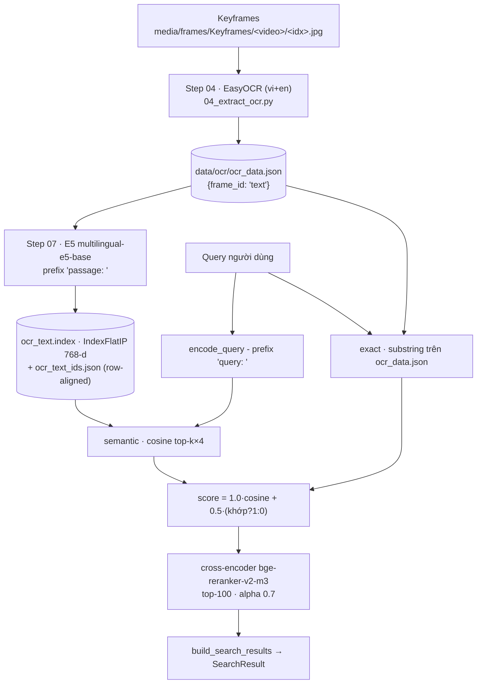

# OCR & Qwen2.5-VL trong HCM-AIC-2026 - ứng dụng và lộ trình cải thiện

> Tài liệu giải thích **OCR đang được dùng ở đâu**, **Qwen2.5-VL đang ở trạng thái nào**,
> vì sao chất lượng OCR hiện tại là điểm nghẽn, và **làm gì tiếp theo** trên hạ tầng
> Kaggle/Colab GPU free.
> Snapshot mã nguồn & dữ liệu: **2026-08-01**, nhánh `main`, commit `227cda3`.
> Bổ sung cho [IMPROVEMENT_ANALYSIS.md](IMPROVEMENT_ANALYSIS.md) (phân tích toàn hệ thống) -
> ở đây chỉ đào sâu trục OCR/VLM.

---

## 1. TL;DR

1. **Production đang chạy EasyOCR**, không phải Qwen. `backend/data/ocr/ocr_data.json`
   có 54.955 entry / 60 video, và chất lượng tiếng Việt kém thấy rõ: `TỈNH TRaNG SỤT LÚN Ờ ĐBSCL`
   (đúng: *TÌNH TRẠNG SỤT LÚN Ở ĐBSCL*), `thủy lgi`, `mẩl tích`, `nguòi`.
2. **Qwen2.5-VL mới chỉ là 2 notebook Kaggle, chưa từng chạy.** Không tồn tại
   `backend/data/captions/` cũng như `caption_text.index` → `/search_caption` trả 503 và
   kênh `caption` của agent là no-op, dù backend đã viết đủ và chờ sẵn.
3. **Hành động số 1**: chạy notebook `09_extract-ocr-caption-qwen.ipynb` trên Kaggle.
   Một lần inference thu được **cả** `ocr_data.json` chất lượng cao **lẫn** `caption_data.json`
   đang thiếu - mở khoá luôn một kênh tìm kiếm đang chết.

Điểm quan trọng nhất cần hiểu: **OCR không chỉ là một tab tìm kiếm.** Nó còn là bộ lọc
chạy xuyên qua *mọi* kết quả trả về và là một trong bốn kênh của agent. OCR sai làm hỏng
ba đường cùng lúc, không chỉ `/search_ocr`.

---

## 2. OCR đang được dùng ở đâu - bản đồ end-to-end

### 2.1 Luồng dữ liệu



### 2.2 Bảng mắt xích (đã đối chiếu mã nguồn)

| Tầng | Vị trí | Ghi chú |
|---|---|---|
| Trích xuất | [04_extract_ocr.py:40](../data_processing/04_extract_ocr.py#L40) - `easyocr.Reader(config.OCR_LANGS)` | `OCR_LANGS="en,vi"`, `OCR_BATCH_SIZE=16` ([config.py:171-172](../data_processing/config.py#L171-L172)). Resumable, checkpoint mỗi batch |
| Định dạng | `data/ocr/ocr_data.json` = `{"<frame_id>": "text đã nối", ...}` | `frame_id = <video_name>_<idx>` |
| Index | [07_build_text_indexes.py:56-70](../data_processing/07_build_text_indexes.py#L56-L70) - `build_ocr()` | E5 cần prefix `passage: `; frame có text rỗng bị bỏ khỏi index |
| Encode query | `services/text_embedding_service.encode_query` - tự thêm `query: ` | Model phải **khớp** [backend/config.py:55](../backend/config.py#L55) |
| Chấm điểm | [ocr_service.py:98-123](../backend/services/ocr_service.py#L98-L123) - `search_ocr()` | `score = ocr_sem_weight·cosine + ocr_exact_bonus·(substring?1:0)`, mặc định `1.0 / 0.5` ([config.py:57-58](../backend/config.py#L57-L58)) |
| Exact score | [ocr_service.py:46-53](../backend/services/ocr_service.py#L46-L53) | `text.count(q) / số_từ` - quét tuyến tính toàn bộ dict |
| Fallback | [ocr_service.py:56-60](../backend/services/ocr_service.py#L56-L60) | Thiếu model/index → fuzzy (rapidfuzz) hoặc exact thuần |
| Rerank | [ocr_service.py:78-95](../backend/services/ocr_service.py#L78-L95) | `BAAI/bge-reranker-v2-m3`, `rerank_candidates=100`, `text_rerank_alpha=0.7` ([config.py:74-75](../backend/config.py#L74-L75)) |
| Endpoint | [search_ocr.py:10](../backend/routers/search_ocr.py#L10) | `POST /search_ocr` - over-fetch `top_k*3` rồi lọc |
| **Bộ lọc toàn cục** | [metadata_service.py:119](../backend/services/metadata_service.py#L119) - `ocr_filter` → `frame_has_ocr_text` | Chạy trong `build_search_results`, tức **mọi** endpoint đều đi qua |
| Lọc theo cảnh | [graph_service.py:168](../backend/services/graph_service.py#L168) - `apply_scene_text_filter` | Gộp OCR của các frame trong cảnh + ASR trùng thời gian, `graph_scene_text_bonus=0.3` |
| Temporal | [search_temporal.py:102-105](../backend/routers/search_temporal.py#L102-L105) | Mỗi event có `ocr1/ocr2/ocr3` riêng |
| Agent | [agent_service.py:193-198](../backend/services/agent_service.py#L193-L198) | `ocr` là 1/4 kênh fan-out, gọi với `rerank=False` cho nhanh |
| Frontend | [SearchPage.jsx:38](../frontend/src/pages/SearchPage.jsx#L38), [useSearch.js:55](../frontend/src/hooks/useSearch.js#L55) | Mode `ocr` + ô lọc OCR riêng cho mode text/image |

### 2.3 Ba đường OCR ảnh hưởng tới kết quả

1. **Kênh tìm kiếm chính** - `/search_ocr`, người dùng gõ chữ nhìn thấy trên màn hình.
2. **Bộ lọc cứng** - `ocr_keywords` trong `/search_text`, `/search_image`, `/search_ocr`.
   Đây là đường nguy hiểm nhất: `frame_has_ocr_text` chỉ so `keyword.lower() in text.lower()`
   ([ocr_service.py:39-43](../backend/services/ocr_service.py#L39-L43)) - OCR sai một dấu là
   frame **đúng** bị loại thẳng khỏi kết quả.
3. **Chứng cứ cho agent** - `/agent/qa` gửi OCR/ASR của cảnh cho Gemini vision để trả lời;
   OCR rác đi thẳng vào prompt và làm nhiễu câu trả lời.

---

## 3. Qwen2.5-VL đang ở đâu - trạng thái thật

### 3.1 Hai notebook đã có

| | `09_extract-ocr-caption-qwen.ipynb` | `10_extract-ocr-qwen.ipynb` |
|---|---|---|
| Nhiệm vụ | OCR **+ caption** trong 1 lần generate | Chỉ OCR |
| Output | `ocr_caption/<video>.json` → `ocr_data.json` **và** `caption_data.json` | `OCR/<video>.json` → `ocr_data.json` |
| JSON trả về | `{"ocr": ..., "caption": ...}` | `{"ocr": ...}` |
| `MAX_NEW_TOKENS` | 220 | 160 |
| `CHECKPOINT_EVERY` | 50 | 32 |
| Thêm vào repo | trước 227cda3 | **227cda3** (2026-07-29) |

Cấu hình dùng chung: `MODEL_ID='Qwen/Qwen2.5-VL-3B-Instruct'` (fp16 ~7GB, vừa T4 16GB;
bản 7B để comment sẵn), `FRAME_STRIDE=1`, `BATCH_SIZE=1`, `MAX_IMAGE_SIDE=768`,
`attn_implementation='sdpa'`, `do_sample=False` (greedy - để JSON parse ổn định),
resumable 2 cấp (bỏ qua cả video đã xong, và bỏ qua từng frame đã có).

Prompt của notebook 10 ép model trả **đúng một** JSON object, giữ nguyên dấu tiếng Việt,
nối nhiều vùng text theo thứ tự đọc trên→dưới trái→phải, không có text thì trả chuỗi rỗng.
`_parse_ocr_json` dùng regex `\{.*?\}` nên chịu được cả khi model lỡ bọc ```` ```json ````.

### 3.2 Chưa chạy - bằng chứng

```
$ ls backend/data/
asr  indexes  metadata  ocr          # không có captions/

$ ls backend/data/indexes/
asr_text.index  asr_text_meta.json  id_map_siglip.json
ocr_text.index  ocr_text_ids.json   siglip.index      # không có caption_text.index
```

Hệ quả dây chuyền:

- [caption_service.py:37-38](../backend/services/caption_service.py#L37-L38) `captions_available()`
  trả `False` → `search_captions` trả `[]` → `/search_caption` trả **503**.
- [agent_service.py:199-201](../backend/services/agent_service.py#L199-L201) kênh `caption`
  luôn trả rỗng → Plan-and-Execute mất 1/4 tín hiệu.
- `/search_caption` **cũng chưa được nối vào frontend** ([useSearch.js:54-56](../frontend/src/hooks/useSearch.js#L54-L56)
  chỉ dispatch `/search_text` và `/search_ocr`) - kể cả có dữ liệu vẫn phải wiring thêm.

Lưu ý thiết kế đã có sẵn: caption dùng `caption_exact_bonus = 0.25`, nhỏ hơn OCR (`0.5`)
([config.py:63-64](../backend/config.py#L63-L64)) - vì caption là văn bản **sinh ra**, khớp
nguyên văn không có giá trị chứng cứ như chữ thật trên màn hình. Chi tiết này nên giữ nguyên
khi có dữ liệu.

---

## 4. Vì sao EasyOCR là điểm nghẽn - bằng chứng, không cảm tính

Số liệu đo trên `backend/data/ocr/ocr_data.json`:

| Chỉ số | Giá trị |
|---|---|
| Số entry | 54.955 (60 video) |
| Text rỗng | 89 |
| Text < 5 ký tự | 278 |
| Độ dài trung bình / trung vị | 105 / 100 ký tự |

Trích nguyên văn (copy từ file, không gõ lại):

```
L21_V001_000434 : "792 TỈNH TRaNG SỤT LÚN Ờ ĐBSCL ĐANG DlỀN RA RẤT NHANH"
L21_V001_020611 : "06,43,20 79 'n hai dàn tử vong duới kênh thủy lgi Son La: Phá hai vu án ma túy có số lon nguòi ong luong"
L21_V001_020825 : "79 06,43,27 HP Sao ~onann vu án ma túy có số lán , thu khẩu Son La: Tim thay thi thể nan nhân mẩl tích 6}C} 0i994 63*83 1366.32 luang giữ sung"
L21_V001_021242 : "06,43,41 79 m giam môt chúng viên vì thiếu trách nhiêm gây hâu quả nghiêm Bác Giang: Bảl  cong Irong"
```

Bốn nhóm lỗi, xếp theo mức thiệt hại:

1. **Sai dấu tiếng Việt** - `TRaNG` ← *TRẠNG*, `Ờ` ← *Ở*, `DlỀN` ← *DIỄN*, `thủy lgi` ← *thủy lợi*,
   `mẩl tích` ← *mất tích*, `nguòi` ← *người*.
   → **Đây là lỗi chí tử.** Cả `_exact_scores` lẫn `frame_has_ocr_text` đều so chuỗi thô;
   sai một dấu là mất điểm exact bonus **và** bị bộ lọc `ocr_keywords` loại bỏ.
2. **Nhiễu HUD** - đồng hồ `06,43,20`, logo kênh `79`/`79D`/`792`, rác số `6}C} 0i994 63*83 1366.32`.
   Nhiễu này chiếm phần đáng kể trong 105 ký tự trung bình → làm loãng vector E5 của cả frame.
3. **Sai thứ tự đọc / cắt xén ticker** - `Bác Giang: Bảl  cong Irong`, `'n hai dàn tử vong`.
   Chữ chạy bị đọc lệch cột, câu gãy giữa chừng.
4. **Trộn nhiều vùng text vào một chuỗi** - headline + ticker + logo + đồng hồ nối liền nhau,
   trong khi chúng nói về **các tin khác nhau**. Một vector cho hỗn hợp này gần như vô nghĩa
   về mặt ngữ nghĩa.

Qwen2.5-VL xử lý tốt cả 4 nhóm: nó đọc theo ngữ cảnh ngôn ngữ (nên dấu đúng), phân biệt được
vùng text, và prompt có thể yêu cầu bỏ qua HUD.

---

## 5. Lộ trình cải thiện

Toàn bộ thiết kế theo hạ tầng **Kaggle/Colab GPU free** (T4 16GB, phiên tối đa 12h).

### P0 - Chạy Qwen2.5-VL để thay `ocr_data.json`

**Chọn notebook 09 (OCR + caption), không phải 10.**
Chi phí GPU nằm ở việc nạp ảnh và forward vision encoder - phần đó *giống hệt nhau* giữa hai
notebook. Notebook 09 chỉ sinh thêm ~60 token caption nhưng thu về `caption_data.json` đang
thiếu, mở khoá `/search_caption` và kênh `caption` của agent. Đánh đổi: chậm hơn ~1.3–1.5×,
JSON 2 field dễ parse lỗi hơn 1 field. Chỉ lùi về notebook 10 nếu quota Kaggle quá căng hoặc
tỉ lệ parse lỗi của 09 vượt ~5% trong smoke test.

**Bốn chỉnh sửa nên làm trước khi chạy toàn corpus:**

1. **Giảm số frame phải OCR (tiết kiệm lớn nhất).**
   Keyframe liên tiếp trong cùng cảnh gần như trùng text hoàn toàn - xem `L21_V001_020353`
   và `L21_V001_020354` trong dữ liệu hiện tại, chỉ khác nhau vài ký tự nhiễu. Thay vì chạy
   `FRAME_STRIDE=1` trên toàn bộ 54.955 frame, hãy chỉ OCR **frame đại diện của mỗi cảnh**
   (tận dụng dedup cosine ≥ 0.9 đã có ở [03_build_faiss_index.py](../data_processing/03_build_faiss_index.py),
   hoặc ranh giới cảnh trong `SceneJSON`), rồi lan text sang các frame cùng cảnh khi merge.
   Ước tính giảm 40–60% số lần inference; đánh đổi là sai lệch nhỏ ở frame giáp ranh chuyển cảnh.
   Đây là cách hạ 3–4 phiên 12h xuống còn 1–2 phiên.

2. **Bỏ `MAX_IMAGE_SIDE = 768`.**
   Downscale thủ công về cạnh 768 trước khi đưa vào processor **làm mất chính loại chữ quan
   trọng nhất**: ticker và lower-third chữ nhỏ. Qwen2.5-VL có cơ chế smart-resize riêng -
   nên truyền `min_pixels` / `max_pixels` cho `AutoProcessor.from_pretrained(...)` và để model
   tự quyết, hoặc tối thiểu nâng ngưỡng lên 1024–1280.

3. **Batch thật.** `BATCH_SIZE = 1` bỏ phí GPU. Gộp nhiều ảnh trong một lần
   `processor(text=[...], images=[...])` có padding; với 3B fp16 trên T4 thường chạy được
   batch 4–8 tuỳ độ phân giải.

4. **Prompt: giữ verbatim, đừng bắt model tự lọc HUD.** Yêu cầu model bỏ đồng hồ/logo dễ khiến
   nó bỏ nhầm cả chữ thật. Cứ để nó chép hết rồi lọc ở bước hậu xử lý (P1) - nơi ta kiểm soát
   được và có thể sửa lại.

**Sau khi có file mới:**

```bash
# 1. Copy về backend
cp ocr_data.json      backend/data/ocr/ocr_data.json
mkdir -p backend/data/captions
cp caption_data.json  backend/data/captions/caption_data.json

# 2. Build lại text index (tạo cả caption_text.index nhờ build_captions())
cd data_processing && python 07_build_text_indexes.py

# 3. Build lại graph nếu đang dùng (scene text lấy từ OCR)
python 08_build_graph.py --knn

# 4. RESTART BACKEND - bắt buộc
```

> ⚠️ `_load_ocr()` và `_load_captions()` đều có `@lru_cache`
> ([ocr_service.py:30](../backend/services/ocr_service.py#L30),
> [caption_service.py:28](../backend/services/caption_service.py#L28)) - ghi đè file mà không
> restart thì backend vẫn phục vụ dữ liệu cũ trong bộ nhớ. Đây là cái bẫy dễ mất nửa ngày debug.

### P0.5 - Đo trước khi đốt GPU

Đừng chạy 55k frame rồi mới biết có tốt hơn không. Gán tay ~200 frame của 1–2 video làm
ground truth, đo **CER/WER** của EasyOCR và Qwen trên chính tập đó. Chỉ chạy toàn corpus khi
Qwen thắng rõ rệt. Việc này khớp với hạng mục A9 (evaluation infrastructure) trong
[IMPROVEMENT_ANALYSIS.md](IMPROVEMENT_ANALYSIS.md) - và tập 200 frame này tái sử dụng được
cho mọi thay đổi OCR về sau.

### P1 - Hậu xử lý & chống hallucination

- **Chuẩn hoá Unicode NFC** (`unicodedata.normalize('NFC', text)`) cho cả text index lẫn query.
  Bắt buộc: tiếng Việt có tổ hợp dấu ở hai dạng biểu diễn khác nhau, không chuẩn hoá thì
  exact-match trượt một cách ngẫu nhiên mà không ai hiểu vì sao.
- **Tách nhiễu HUD.** Chuỗi lặp lại ở nhiều video khác nhau (logo kênh, khung giờ) gần như
  chắc chắn là HUD. Đếm tần suất theo video, chuỗi nào xuất hiện ở > N video thì tách khỏi
  text nội dung (giữ trong field riêng nếu vẫn muốn tìm được).
- **Rủi ro mới mà EasyOCR không có: VLM bịa chữ.** Khi frame không có text, model có thể
  sinh ra câu nghe hợp lý. Prompt đã yêu cầu trả chuỗi rỗng và dùng greedy decode, nhưng vẫn
  phải kiểm hậu kiểm: thống kê phân bố output, cờ đỏ khi **một câu y hệt** lặp lại ở nhiều
  video không liên quan. So sánh chéo với output EasyOCR cũ là cách rẻ để phát hiện.

### P1 - Cải thiện kênh OCR ở backend (độc lập với Qwen, làm song song được)

- **`exact_bonus` gần như chết lâm sàng.** [ocr_service.py:51](../backend/services/ocr_service.py#L51)
  so **toàn bộ query** như một substring: `if q in text_l`. Query nhiều từ ("phát hiện hai
  người tử vong dưới kênh") gần như không bao giờ khớp nguyên văn → nhánh `exact` đóng góp 0.
  Sửa theo hướng BM25 / RRF (mục A3 của [IMPROVEMENT_ANALYSIS.md](IMPROVEMENT_ANALYSIS.md)).
- **Thêm biến thể bỏ dấu khi so khớp** (fold diacritics cả hai phía). Kể cả Qwen cũng sẽ sai
  dấu ở vài phần trăm; fold dấu biến lỗi đó từ *trượt hoàn toàn* thành *vẫn tìm được*.
- **Index theo dòng thay vì theo frame** - đề xuất riêng của tài liệu này, chưa có trong
  IMPROVEMENT_ANALYSIS. Hiện mỗi frame là một row chứa headline + ticker + logo nối chuỗi
  ([07_build_text_indexes.py:58-61](../data_processing/07_build_text_indexes.py#L58-L61)),
  embed chung làm loãng vector. Cho notebook xuất thêm `ocr_lines.json`
  (`{frame_id: ["<phần tử text 1>", "<phần tử text 2>", ...]}`) rồi index **từng phần tử**
  (nhiều row → cùng một `frame_id`, lấy max khi gộp điểm). Precision tăng đáng kể vì mỗi
  vector nói về đúng một tin. `ocr_data.json` phẳng vẫn giữ nguyên để không phải đụng backend.
- **E5-base → BGE-M3** (mục A4). Phải rebuild cả 3 index và sửa `text_embed_model` khớp nhau
  ở hai phía, nếu không backend sẽ so vector khác chiều.

### P2 - Dọn dẹp & mở rộng

- [search_ocr.py:14](../backend/routers/search_ocr.py#L14) có tham số chết
  `model: str = "beit3"` - không được dùng, và cả hệ thống mặc định `siglip`
  ([backend/config.py](../backend/config.py)). Bỏ hoặc đổi mặc định.
- Nối `/search_caption` vào frontend sau khi có `caption_data.json`
  ([useSearch.js:54-56](../frontend/src/hooks/useSearch.js#L54-L56),
  [SearchPage.jsx:38](../frontend/src/pages/SearchPage.jsx#L38)).
- [BACKEND_API_SPEC.md](../BACKEND_API_SPEC.md) (dòng 72, 375-376) vẫn mô tả OCR index là
  Elasticsearch / SQLite FTS5 + BM25 - **sai** so với hiện thực FAISS + E5 hybrid. Cần sửa
  để không ai đọc spec rồi code nhầm.
- **Scene-level caption** (mục B7): caption cả cảnh thay vì từng frame, giàu ngữ cảnh hơn.
  Chỉ làm sau khi caption per-frame đã chạy ổn.

---

## 6. Bảng ưu tiên

| Ưu tiên | Hạng mục | Chạm vào | Effort | Impact |
|---|---|---|---|---|
| 🥇 P0 | Gán tay 200 frame + đo CER/WER EasyOCR vs Qwen | tập eval mới | Thấp | **Cao** (chặn rủi ro) |
| 🥇 P0 | Chạy notebook 09 trên Kaggle (kèm 4 chỉnh sửa §5) | `kaggle/09_*.ipynb` | Trung bình | **Rất cao** |
| 🥇 P0 | Dedup theo cảnh trước khi OCR | logic merge trong notebook | Thấp | Cao (giảm 40–60% GPU) |
| 🥈 P1 | Chuẩn hoá NFC + lọc HUD + hậu kiểm hallucination | bước merge / script mới | Thấp | Cao |
| 🥈 P1 | BM25/RRF thay `count(q)/word_count` | `ocr_service.py:46-53` | Thấp | Trung bình–Cao |
| 🥈 P1 | Fold dấu khi so khớp exact & filter | `ocr_service.py:39-53` | Thấp | Trung bình |
| 🥉 P2 | Index theo dòng (`ocr_lines.json`) | notebook + `07_build_text_indexes.py` | Trung bình | **Cao** |
| 🥉 P2 | E5 → BGE-M3 | `backend/config.py:55` + rebuild 3 index | Trung bình | Trung bình |
| 🥉 P2 | Nối `/search_caption` vào frontend | `useSearch.js`, `SearchPage.jsx` | Thấp | Trung bình |
| P3 | Bỏ tham số chết `model="beit3"`, sửa API spec | `search_ocr.py:14`, `BACKEND_API_SPEC.md` | Rất thấp | Thấp (đúng đắn) |

---

## 7. Checklist thi hành

```
[ ] Gán tay ~200 frame của 1–2 video → ocr_eval.json
[ ] Đo CER/WER EasyOCR baseline trên tập đó
[ ] Sửa notebook 09: min_pixels/max_pixels thay MAX_IMAGE_SIDE=768
[ ] Sửa notebook 09: BATCH_SIZE 1 → 4~8
[ ] Sửa notebook 09: chỉ OCR frame đại diện mỗi cảnh
[ ] Smoke test 50 frame → kiểm tỉ lệ parse JSON lỗi (< 5%) + đo CER/WER Qwen
[ ] So sánh: Qwen có thắng rõ EasyOCR không? Nếu KHÔNG → dừng, xem lại prompt
[ ] Chạy toàn corpus (resumable, checkpoint đều)
[ ] Merge → ocr_data.json + caption_data.json
[ ] Hậu xử lý: NFC + lọc HUD + hậu kiểm hallucination
[ ] cp về backend/data/{ocr,captions}/
[ ] python 07_build_text_indexes.py  (tạo cả caption_text.index)
[ ] python 08_build_graph.py --knn   (nếu dùng graph)
[ ] RESTART BACKEND  ← lru_cache
[ ] Kiểm: POST /search_caption không còn trả 503
[ ] Đo lại chất lượng tìm kiếm trên tập eval, so với baseline
```

---

> **Ghi chú**: mọi con số và trích dẫn trong tài liệu này được đo/copy trực tiếp từ mã nguồn
> và `backend/data/ocr/ocr_data.json` ngày 2026-08-01. Khi `ocr_data.json` được thay bằng
> output Qwen, §4 sẽ không còn đúng - hãy cập nhật lại phần đó bằng số đo mới thay vì xoá,
> để giữ được bằng chứng so sánh trước/sau.
