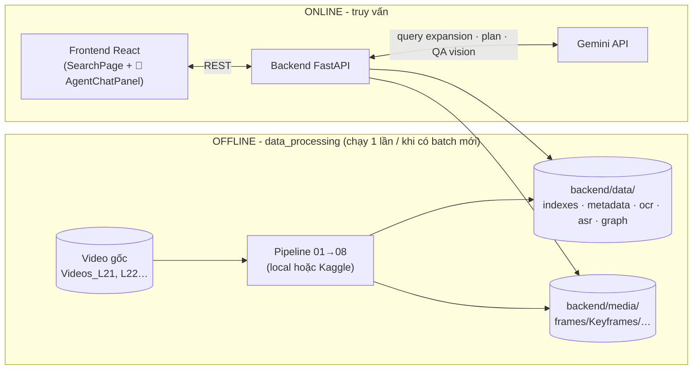
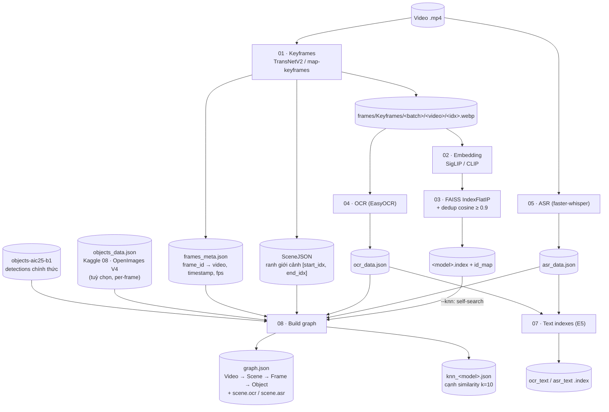
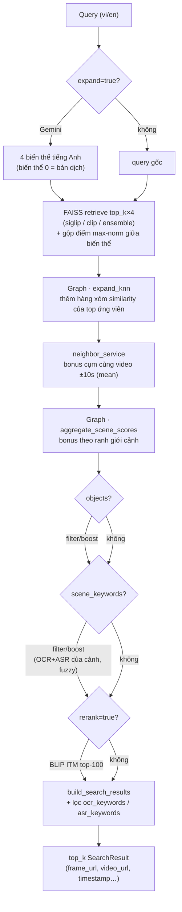
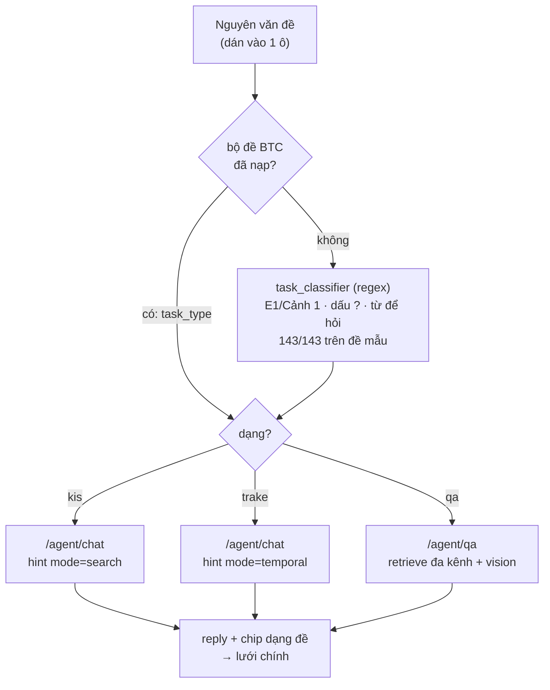
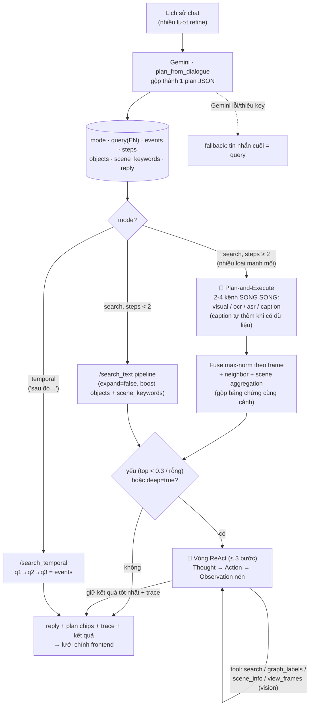
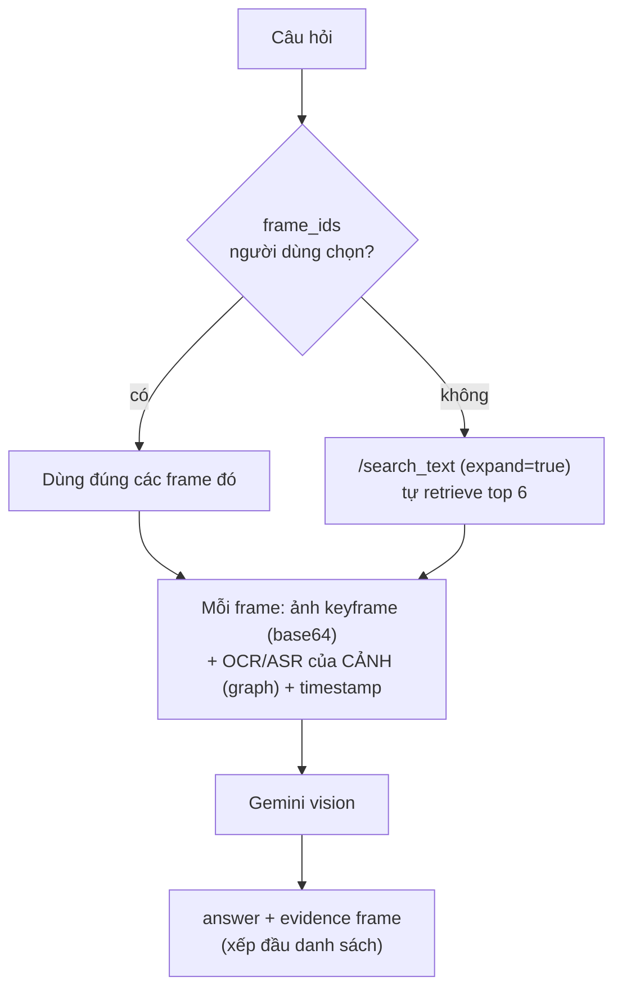
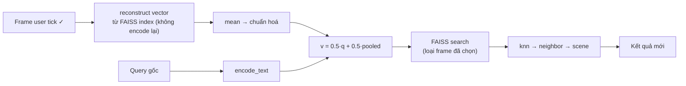
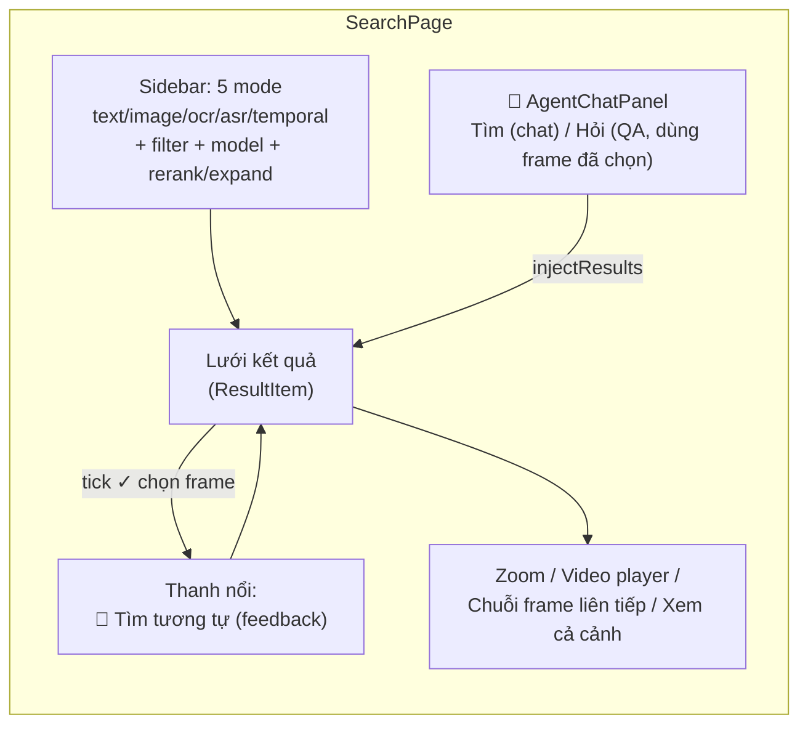

# HCM-AIC-2026 - Pipeline & Flow

Tài liệu mô tả luồng dữ liệu offline (data processing) và luồng xử lý online
(backend + frontend) của hệ thống. Chi tiết API: [BACKEND_API_SPEC.md](BACKEND_API_SPEC.md).

## 1. Kiến trúc tổng thể

## 2. Pipeline offline (data_processing 01→08)

| Bước | Script local | Notebook Kaggle | Output |
|------|--------------|-----------------|--------|
| 01 | `01_extract_keyframes.py` (TransNetV2) / `01b` (map CSV) | `01`, `02`, `03` | `media/frames/…`, `frames_meta.json`, SceneJSON |
| 02 | `02_extract_features.py` | `04_infer-embedding` | `features/<model>/<video>/<frame>.npy` |
| 03 | `03_build_faiss_index.py` (dedup 0.9) | `05_create-index/bin` | `<model>.index` + `id_map_<model>.json` |
| 04 | `04_extract_ocr.py` (EasyOCR vi+en) | `06_extract-ocr` | `ocr/ocr_data.json` |
| 05 | `05_extract_asr.py` (faster-whisper) | `07_extract-asr` | `asr/asr_data.json` |
| 07 | `07_build_text_indexes.py` (E5) | - | `ocr_text.index`, `asr_text.index`, `caption_text.index` + sidecar |
| 08 | `08_build_graph.py` (`--knn`) | `08_extract-objects` (input) | `graph/graph.json`, `graph/knn_<model>.json` |
| 09 | - (chỉ Kaggle) | `09_extract-ocr-caption-qwen` (Qwen2.5-VL-3B) | `ocr_data.json` (thay 04) + `captions/caption_data.json` |

## 3. Luồng search chính (`POST /search_text`)

Thứ tự đúng như code ([routers/search_text.py](backend/routers/search_text.py)):

Các luồng khác dùng chung khối trên: `/search_image` (encode ảnh thay text,
không expand/rerank), `/search_ocr` `/search_asr` (E5 semantic + exact/fuzzy),
`/search_temporal` (retrieve từng event → beam search chuỗi theo thời gian).

## 4. Luồng agent (MemoriEase-style)

### 4.0 `POST /agent/ask` - một cửa, ba đường

Người thi dán nguyên đề vào một ô; backend nhận dạng dạng đề rồi rẽ. Ba pipeline
bên dưới KHÔNG gộp - chúng khác nhau ở bản chất retrieval (xem 4.1, 4.2 và
`qa_select_evidence`): KIS fuse theo frame + gom neighbor/scene, TRAKE fuse theo
từng event rồi ghép chuỗi trong một video, QA fuse theo VIDEO và luôn bật kênh
ASR/OCR. Đo trên SOTUYEN2: ép kênh ASR/OCR cho KIS kéo top-5 từ 22/30 xuống
13/30; gom neighbor cho QA đè mất video đúng.

### 4.1 `POST /agent/chat` - tìm kiếm hội thoại

### 4.2 `POST /agent/qa` - hỏi đáp RAG

### 4.3 `POST /search_feedback` - relevance feedback

## 5. Frontend flow

## 6. Các tín hiệu xếp hạng (tổng hợp)

| Tín hiệu | Service | Khi nào |
|----------|---------|---------|
| Cosine SigLIP/CLIP (+ ensemble, + query expansion) | `faiss/embedding/ensemble/query_expansion` | luôn |
| kNN expansion (cạnh similarity) | `graph_service.expand_knn` | có `knn_<model>.json` |
| Neighbor bonus (cửa sổ ±10s) | `neighbor_service` | luôn |
| Scene bonus (ranh giới cảnh) | `graph_service.aggregate_scene_scores` | có `graph.json` |
| Object filter/boost (nhãn OpenImages của cảnh) | `graph_service.apply_object_filter` | param `objects` |
| Scene text filter/boost (OCR+ASR cảnh, fuzzy) | `graph_service.apply_scene_text_filter` | param `scene_keywords` |
| BLIP ITM rerank (query–ảnh) | `rerank_service` | `rerank=true` |
| Lọc OCR/ASR hậu kỳ | `metadata_service` | param `ocr/asr_keywords` |
